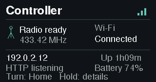
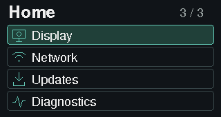
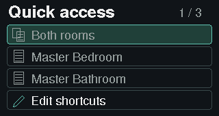
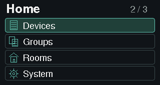
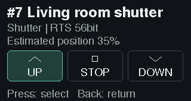
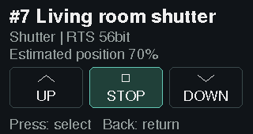
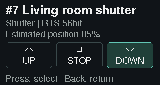

# ESPSomfy RTS for LILYGO T-Embed CC1101 and CC1101 Plus

Control Somfy RTS shutters, blinds and shades from the LILYGO LCD, a browser, or Home Assistant. This fork builds on **cjkas v4.0.2** and adds local LCD controls, web dark mode and verified GitHub updates for both T-Embed CC1101 boards.

Somfy **io-homecontrol** motors do not speak RTS and need a different controller. ESPSomfy supports up to 32 devices and 16 groups; configure the radio frequency to match your motors.

## Install or update

Use the shared **`lilygo-t-embed-cc1101`** build for either T-Embed CC1101 or CC1101 Plus with 16 MB flash and 8 MB PSRAM. Other ESP32 boards require their own firmware; this LCD build is not interchangeable with generic ESP32-S3 images.

1. **Back up first.** Export the existing controller configuration and save a fresh full-flash recovery copy. Preserve radio settings, shutter identities, calibration, groups and current rolling codes—the counters motors use to recognize valid commands.
2. **Coming from another firmware?** Follow [Install from another firmware](docs/first-install.md) before choosing an upload method. Matching partition layouts allow a firmware-only update; older layouts require a USB migration that preserves the existing data. Do not erase the board or upload a factory image over a configured controller.
3. **Already on this build?** Open **Home → Updates** on the LCD, check GitHub, review the release, then choose **Install and restart**. Keep power connected. See the [LCD update guide](docs/lcd-github-updates.md).
4. **After reboot**, check the version in **System → About** and compare your saved shutter/radio settings. The [flashing guide](docs/flashing.md) covers backup, boot confirmation, verification and recovery.

Download the firmware and its update manifest from this fork’s [releases](https://github.com/SidShaytay/ESPSomfy-RTS/releases). A commit on `main` is available to build, but becomes a downloadable update only after its release assets are published.

### One firmware file includes the web interface

The shared LILYGO build embeds the controller, LCD and matching web interface in **one firmware image**. Upload `firmware-lilygo-t-embed-cc1101.bin` through the browser’s **Update Firmware** action, or let the LCD updater fetch it. You no longer upload a separate app/web image for this build. Firmware and web UI also roll back together.

LittleFS remains on the device for private configuration; it is not replaced during a firmware-only update. The LILYGO package contains **no `littlefs.bin`**, and `/updateApplication` refuses uploads. Generic ESP32 builds retain their separate firmware/filesystem workflow.

## Use the LCD

Turn the wheel to select, press to open or activate, and use the Back button to return. From the default Status screen, turn or press to reach three navigation pages: Quick access, Devices/Groups/Rooms/System, then Display/Network/Updates/Diagnostics. Turn backwards to retrace them.

| Default Status screen | Navigation page 3 of 3 |
| --- | --- |
|  |  |

| Quick access, page 1 of 3 | Home, page 2 of 3 |
| --- | --- |
|  |  |

Pin up to three devices or groups in Quick access. Browse configured rooms, devices and groups, adjust display brightness/dim/sleep, or open System for settings and maintenance. The LCD uses the controller’s configured PIN or password when security is enabled.

### Move and stop a shutter

Open a device or group, select **UP**, **STOP** or **DOWN**, then press the wheel. **More** offers the position, tilt, MY/favourite, step and sun controls supported by that target. Numeric targets require a separate review; turning the wheel or cancelling a draft sends no movement command.

| UP selected | STOP during travel | DOWN selected |
| --- | --- | --- |
|  |  |  |

Positions are **estimates**, not motor feedback. While a shutter is estimated moving, the display stays awake so STOP remains accessible. MY recalls or sets a favourite and is distinct from STOP; follow the [LCD control guide](docs/lilygo-local-ui.md) before programming favourites or motor settings.

These 320×170 screenshots come from the production renderer with synthetic settings and movement state. They illustrate the screens without operating a real shutter. See [screenshot reproduction](docs/images/lcd/README.md).

## Choose light or dark mode

In the browser, use **Appearance → System, Light or Dark**. System follows your operating system; an explicit selection is saved in that browser and used on later visits. The LCD keeps its own dark layout and independent brightness controls.

## What changed from earlier firmware

- **LILYGO display and controls:** local shutter/group control, three shortcuts, room browsing, settings, diagnostics, battery status and updates on the integrated 320×170 LCD.
- **cjkas fixes retained:** asynchronous web/socket handling to address restart and watchdog problems, scheduled radio transmission with locking, compressed web assets, RAM-based backup generation, and corrected restore-option handling. The maintained baseline is pinned to [cjkas v4.0.2](https://github.com/cjkas/ESPSomfy-RTS/tree/07bffdec6b540cc99f31d02d7e6de6d3d1e7f8f3); see the [baseline decision](docs/adr/0008-lilygo-maintained-baseline.md).
- **Vulnerability hardening:** authenticated HTTP/WebSocket operations in Secured mode, same-origin WebSocket checks, Wi-Fi names rendered as text, bounded SSDP parsing, restore-count validation and supported radio frame lengths. This fork also reserves board pins and checks current target identities before local commands. These are specific safeguards, not a guarantee against every vulnerability.
- **GitHub updates restored on LILYGO:** cjkas removed the old updater because fragmented internal RAM could not satisfy large TLS allocations, certificate checking was disabled, and blocking work ran in the web task. The replacement puts large TLS allocations and firmware staging in external **PSRAM**, limits small internal allocations, verifies HTTPS certificates and firmware identity/digests, and uses a background downloader with loop-owned installation. It does not revive the old GitOTA. Read the [updater design](docs/github-update-service.md) and [memory policy](docs/board-memory.md).
- **Consistent firmware and web UI:** one LILYGO image updates and rolls back both, preserving the private filesystem on a matching layout.
- **Network stability:** discovery sends run in the controller loop rather than Wi-Fi callbacks, addressing the investigated event-task panic.

A physical LCD GitHub installation, boot-health confirmation and state-preserving readback succeeded during engineering qualification. Remaining physical control, other-board and combined-load checks are recorded in [the qualification plan](docs/lcd-completion-qualification.md). Publishing this release does not establish those unmeasured outcomes.

## Connect Home Assistant or scripts

This firmware uses **protocol 2** and the cjkas-compatible Home Assistant integration, version **3.0.0 or newer**. Older rstrouse/v2 clients need migration; check the [compatibility notes](LILYGO.md#state-and-home-assistant-compatibility) before upgrading the controller.

| Interface | Address or route |
| --- | --- |
| Browser | `http://<device>/` |
| Commands | `/shadeCommand`, `/groupCommand`, `/tiltCommand` |
| Login | `/loginContext`, then `/login` |
| Backup / restore | `/backup`, `/restore` |
| Firmware upload | `/updateFirmware` |
| State, settings, edits and events | `ws://<device>/ws`; see [protocol reference](docs/PROTOCOL.md) |

All services use port **80**; the former ports 8080/8081 and old state-reading HTTP routes are gone. In Secured mode, protected HTTP routes require the token returned by `/login` in an `apikey` header; the socket uses `?apikey=<token>`. Former “Secure Config Only” settings become Secured, so command clients must authenticate too. Use the device on a trusted local network; local HTTP/WebSocket connections are not encrypted.

## Build locally

Requires Linux, Git, `uv` and internet access for the pinned tools. From the checkout, run:

```bash
bash tools/setup-lilygo.sh
bash tools/build-lilygo.sh
```

The scripts build without accessing a controller. The validated package is written under `build/lilygo-t-embed-cc1101/artifacts/`. See [LILYGO.md](LILYGO.md) for the pinned pioarduino toolchain, hardware wiring, partition table and package checks.

## Troubleshoot and find more help

- **Updater refuses an image:** verify the exact board/profile, partition layout and release assets. A generic S3 binary is not the shared LILYGO build.
- **Coming from engineering 4.9.x:** v4.1.0 sorts older. Use the verified manual firmware-only upload path once; subsequent newer public releases can use the LCD updater.
- **Settings missing after migration:** stop before pairing or moving anything. Preserve current flash and follow [recovery](docs/flashing.md#if-installation-or-verification-fails); restoring old counters blindly can make motors reject commands.
- **LCD screenshot unavailable:** protected, busy and allocation-fallback screens can legitimately refuse capture. See the [LCD guide](docs/lilygo-local-ui.md).

[First installation](docs/first-install.md) · [LCD guide](docs/lilygo-local-ui.md) · [Hardware and builds](LILYGO.md) · [Release notes](docs/releases/v4.1.0.md) · [Upstream hardware and motor guides](https://github.com/rstrouse/ESPSomfy-RTS/wiki)

ESPSomfy RTS was created by [rstrouse](https://github.com/rstrouse/ESPSomfy-RTS), maintained and substantially improved by [cjkas](https://github.com/cjkas/ESPSomfy-RTS), and extended here for LILYGO CC1101 boards.
