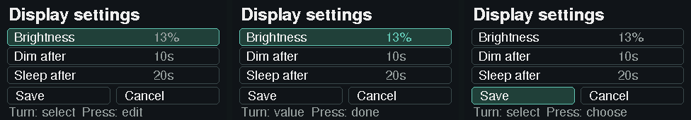

# Local controller UI

Use [the standard flashing procedure](flashing.md) for backup and firmware-only A/B updates. Build `lilygo-t-embed-cc1101` for either CC1101 or Plus; the shared image includes display, UI and commands.

The 320×170 UI adds status, room selection, controls, details and saved display settings to the LILYGO CC1101/Plus display. It follows the approved dark/teal mockup using the real Adafruit fonts and vector drawing; the generated previews use the same renderer as the board.

This guide describes the software in current main, including the full LCD
administration and verified updater. Check **Details** for the running firmware,
application and build identity; a source checkout or version label alone does
not establish what is installed. Dated evidence near the end of this page is
historical. See the [implementation audit](lcd-capability-audit.md) for coverage
and physical-verification limits.

For per-shutter travel, slack and reversal measurement, use [guided calibration](shutter-calibration.md). The same profile controls individual and group positions.

## Navigation versions

The main instructions below apply to **public v4.1.0** and engineering **4.9.x**. Check Details for the installed version.

| Task | 4.7.3 | 4.8.0 | Public 4.1.0 / engineering 4.9.x |
|---|---|---|---|
| Browse targets | Browse & settings → Rooms / Devices / Groups | Browse all → Rooms / Devices / Groups | Home → Devices / Groups / Rooms |
| Settings and administration | Browse & settings → Settings / Administration | This controller → Configure | System → Configure |
| Display and shortcuts | Browse & settings → Display settings / Manage shortcuts | This controller → Configure → Display / Quick entries | Home → Display; Quick access → Edit shortcuts |
| GitHub updates | Browse & settings → System → GitHub updates | This controller → Maintenance → GitHub updates | Home → Updates |
| Restart and browser files | Browse & settings → System | This controller → Maintenance | System → Maintenance |
| Diagnostics | Browse & settings → System | This controller → Diagnostics | Home → Diagnostics |
| WiFi scan | Browse & settings → System → WiFi scan | This controller → Configure → Network → WiFi scan | Home → Network → WiFi scan |
| Status and About | Browse & settings → Status; hold for Details | This controller → Status / About | System → Status / About |

All versions retain protected forms, explicit confirmations and supported commands. Version 4.7.3 requires its original installation session to remain valid. **4.8.0 and later** combine this navigation with the confirmed-install 30-minute window and temporary-download retries; ordinary menu authorization still expires after 120 seconds. See [GitHub updates](lcd-github-updates.md) for cancellation, unlock and failure behavior.

## Start on the LCD

1. Wake the display with one input; that first input sends no command.
2. Quick access shows three pinned devices or groups and **Edit shortcuts**. Turn past the last entry to reach two Home pages: **Devices, Groups, Rooms, System**, then **Display, Network, Updates, Diagnostics**. Turn backwards to retrace the pages. In **public v4.1.0** (and engineering 4.9.1), all three pages use four full-width rows with small vector icons; clockwise moves down. Engineering **4.9.0** uses 2×2 destination grids.
3. Select a shortcut or catalogue target to open its controls. Opening sends no command. **Rooms** lists named rooms and nonempty **Unassigned**; selecting one shows its devices and groups together. Global **Devices** and **Groups** already cover every room.
4. Unlock with the configured web PIN/password when requested. Read the selected action or confirmation before pressing. Back returns to the screen, selection and scroll position you came from.
5. Hold on Status for Details. Open **Home → Updates** for the separate default-Cancel GitHub release review.

Displayed movement and percentages are estimates. STOP uses MY on ordinary RTS
motors; it is not a physical emergency-stop system. One-button Toggle devices
have different stop/reverse semantics and no ordinary STOP action.

## Choose daily shortcuts

**Quick access → Edit shortcuts** edits the three Quick access slots. Select a slot, then
**Pin device**, **Pin group**, **Remove shortcut**, **Move up** or **Move down**.
Choose **Save shortcuts**, review all three targets, then turn from **Cancel** to
**Save** and press. The configured web credential also protects these edits.
Back or **Cancel** on the Manage screen discards the unsaved draft, as does an
expired session. **Cancel** on the final Save review returns to Manage and keeps
your draft. Selecting a target
or changing the draft sends no motor command.

Without saved shortcuts, the UI suggests group ID 1 and device IDs 1 and 2 when
those targets exist. Suggestions stay in memory until you explicitly save them.
Saved empty slots remain empty. A missing target or changed radio identity shows
**Unavailable**; it never selects another device. Restoring the same target ID and
radio identity makes its shortcut usable again after fresh checks.
Names follow the current configuration. In **public v4.1.0** (and engineering 4.9.1), ordinary names use the full label area. Compact typed IDs appear only when names are duplicated, render identically with the LCD font, or are clipped so a distinguishing suffix could be hidden. Internal selection always uses stable typed IDs. Shortcut pins are separate from the motor's MY/Favourite position.

**Home → Devices / Groups / Rooms** opens the target catalogues. **System → Configure** contains settings, Display, Quick entries and **Rooms, devices & groups** administration. Startup opens Quick access when the model is ready
and no movement or pending control needs attention. Ordinary idle navigation
returns to Status before sleep; waking Status returns to Quick access. Waking a
control page preserves it, keeping its existing STOP access and expiry rules.

## Find a workflow

| Task | LCD path and guide |
|---|---|
| Everyday controls and bounded repeats | Target → controls / Actions / Send with repeats; instructions below |
| Position, then set or clear Favourite | Target → Actions → Save current as favourite / Clear saved favourite; [observed-stop stages](lcd-favourite.md) |
| Rooms, devices, groups and ordering | System → Configure → Rooms, devices & groups; [entity administration](lcd-entity-administration.md), [ordering](lcd-ordering.md) |
| Status, paired marker, linked remotes, counters | System → Configure → Rooms, devices & groups → Devices/Groups → Advanced; [status/metadata](lcd-advanced-metadata.md), [counter correction](lcd-primary-counter-correction.md) |
| Pair/unpair one motor | Device Advanced → Pair/unpair guide; [programming guide](lcd-programming-guide.md) |
| Edit group list or program group membership | Group Advanced → Member links or Motor programming; [list repair](lcd-group-membership.md), [motor programming](lcd-group-programming.md) |
| Receive/review repeater or remove association | System → Configure → Rooms, devices & groups → More → Repeaters; [repeater guide](lcd-repeater-learning.md) |
| Explicit remote chords or sensor simulation | Device/group Advanced → Advanced remote / Sensor simulation; [chords](lcd-advanced-remote.md), [sensor guide](lcd-sensor-simulation.md) |
| Settings and secrets | System → Configure; [settings forms](lcd-settings-forms.md) |
| WiFi/network details and scans | System → Diagnostics → Network details / Radio frequency scan; Configure → Network → WiFi scan; [System](lcd-system.md), [WiFi](lcd-wifi-scan.md), [radio scan](lcd-radio-scan.md) |
| Receive diagnostics | System → Diagnostics → Receive diagnostics; [receive guide](lcd-receive-diagnostics.md) |
| Update firmware without a computer | System → Maintenance → GitHub updates; [verified update/rollback](lcd-github-updates.md) |
| Backup, restore, manual files, clipboard/cache | System → Maintenance → Browser files & Web; Diagnostics → Copy receive log supplies browser guidance; [System](lcd-system.md), [generic filesystem files](generic-filesystem-update.md) |

## Use the encoder

- First input after dim/off wakes only. A button held during boot is ignored until released.
- From Status, turn or press to open Quick access. Choose **Browse all** for target catalogues or **System** for controller tasks. Hold for Details; turn there to scroll all fourteen diagnostic rows. Details distinguishes compiled Firmware from installed web-file Application version. Opening About through System returns to that menu; the existing Status hold shortcut retains its normal return.
- In Browse all, turn to Rooms, Devices or Groups, then press. System opens Configure, Maintenance, Status, About or Diagnostics. Status opens the existing wake screen directly; About opens the existing scrolling Details page. Rooms includes All rooms and Unassigned filters. Catalogues show three rows at a time, keep the selected device ID when entries reorder, and handle every configured device/group. Names can repeat; the visible stable ID identifies each target.
- **System → Configure → Rooms, devices & groups → Rooms / Devices / Groups** adds, edits and deletes configuration through protected local forms. Apply changes only the draft; Save performs the edit. Device/group Save and all Delete confirmations start with Cancel selected. Full lists show every stable ID; Add is marked full when no slots remain. If an edit applies but its model file is not saved, Retry saves the current file without repeating the edit. See [entity administration](lcd-entity-administration.md).
- **More → Repeats** opens supported everyday RF actions. Steps ask for their size before the repeat count. Follow [Hold to send repeats](#hold-to-send-repeats) below; the final review differs from an ordinary one-shot Apply.
- On a control page, turn to the available UP/STOP/DOWN or Toggle action and press. More opens additional supported actions: position, tilt, MY position, 80-bit Favorite, steps and sun flags. The menu reflects the actual device capabilities; it adds no separate light opcode. Group actions require compatible configured RF members. An 80-bit group also offers Favorite when every configured member supports it; mixed, missing or incompatible members disable it. This sends one command using the group identity and updates member estimates, without substituting individual member commands.
- Numeric position/tilt drafts range from 0 to 100; steps range from 1 to 127. Turn to adjust, press to review, then turn from the default **Cancel** to **Apply** and press. Turns and Cancel send nothing. An unavailable position estimate prevents opening a position draft rather than choosing a target silently. Back cancels a draft and returns directly to the main control page with STOP selected when supported.
- Push requires the selected row, target, action and Apply choice to have reached the panel. If SPI is busy, wait for the display and press again. A previously shown STOP remains reachable while the same target repaints estimates. Changed identity, configuration or group membership requires reopening the target.
- Back returns without sending a command. An encoder hold also returns from navigation/editors, except on the final **Hold to send** repeat review. Turn the wheel to select Brightness, Dim after or Sleep after, then press to edit. Turn to change the value and press again to save it immediately and return to row selection. Back discards an unconfirmed edit; values already confirmed stay saved. Storage failures are shown.
- Brightness levels are 2, 4, 8, 16, 32, 64, 128 and 255 out of 255 (default 32). Dim/sleep choices are disabled, 5, 10, 15, 20, 30, 60, 120 and 300 seconds. **No dim** disables dimming; **No sleep** keeps the display on. Defaults are dim after 10 seconds and sleep after 20 seconds, measured independently from the last input.
- While any configured shade is estimated moving, the UI stays awake so STOP remains reachable. Wake, rotation and Back create no shutter request; only the explicit repeat-review hold starts repeated commands. With No sleep selected, idle navigation returns to Status after 30 seconds while leaving the display on.



Display settings rendered from synthetic state: selection, editing and a saved value, from left to right.

## Hold to send repeats

1. Open the target’s **More → Repeats** menu and choose a supported RF action. For a step action, choose the step size first.
2. Choose **1–127 repeats**, press to review, then turn from the default **Cancel** to **Hold to send**. Check the target, action, step size and maximum repeat count on the completed display.
3. Hold the encoder for about **800 ms** after the press has debounced. A short tap sends nothing and shows a hold hint. One eligible hold starts one fresh command with the reviewed count; keeping it down never starts a second batch.
4. Release to end future repeat frames. The active footer says **Release ends repeats; then STOP**. Release does not send MY/STOP and does not stop a shutter already moving; release first, then use the separate supported **STOP** action if needed.
5. Read the outcome. Completion, refusal or expiry replaces the active hold hint even while the encoder remains down. Release before starting another action; completing the maximum count while held does not rearm the button.

Wait for the complete review before pressing. If the screen is busy when the press starts, completing it while the knob is still down cannot authorize that hold: release, wait, then press again. Wake-only input, a button held at boot, rotation during the press, or changed target/authorization cancels eligibility. Back, authorization expiry, context changes, timeout and graphics recovery also cancel remaining admitted repeats. Cancellation is observed between complete RF frames; a frame already committed may still finish. Other queued commands are preserved.

The count uses the shared protocol’s repeat definition and may exclude the initial frame; it is not a number of physical movements. MY/STOP, 56-bit Toggle, individual Euro-mode UP/DOWN, position seeks, tilt requests and wired GPIO actions have no everyday repeat option. Their ordinary supported controls remain available. Pairing, Set/Clear Favourite and Advanced remote programming retain their separate staged confirmations and protocol batches.

An accepted action first enters the shared model-loop queue. Unsubmitted actions expire after five seconds and never retry automatically. A started finite repeat job has its own count-derived deadline, so a valid long batch is not cut off at five seconds. **Active; Back cancels remaining** means the local action is still owned, including any cancellation waiting for its final outcome. Changed configuration, authorization, restore history or a backward clock refuses or cancels the old intent. STOP stays available for the same target under its existing security rules.

A fresh STOP for the same unchanged target retracts its queued UP/DOWN/other action. If the target is already idle, this only cancels the queued start and sends no MY. If moving, STOP joins the end of the shared queue. **Cancelled; STOP not queued** means the old start was removed but the queue had no room for the replacement; press again when ready. Other targets' pending actions require explicit Back cancellation. Back cannot undo a command already accepted by the existing request service.

The current font displays ASCII. Unsupported UTF-8 code points and control characters appear as `?`, while stored names remain unchanged. Stable IDs distinguish labels that render identically. Separate/Euro GPIO relay tilt is unavailable because the original web-backed relay driver has no mapping for it. All mode settings, ordinary supported lift and existing RF/GPIO-remote tilt behavior are retained; adding a new actuator design is outside this port.

Configured web credentials also unlock local controls and administration. After two minutes without input, new actions require unlock. Only an already authorized, continuing movement retains ordinary STOP, for at most 30 seconds after the original expiry. Idle, changed configuration, explicit lock or sleep ends that exception; later movement does not regain it. Tilt STOP, MY, Toggle and every other action require unlock after expiry. Numeric drafts discard on timeout, authorization replacement or target changes. See the [interaction and security policy](lcd-interaction-security-design.md) for attempt limits and screenshot protection.

The [manufacturer schematic](https://github.com/Xinyuan-LilyGO/T-Embed-CC1101/blob/master/hardware/T-Embed-CC1101%20V1.0%2024-07-29.pdf) and [component/pin list](https://github.com/Xinyuan-LilyGO/T-Embed-CC1101/blob/master/README.md) do not document an ambient-light sensor. Brightness is manual. The encoder uses INA 4, INB 5 and KEY 0; Back uses GPIO6. The decoder follows the manufacturer's TWO03 mode, recognizing detents at both 00 and 11 and rejecting invalid Gray-code transitions/bounce. Dated bring-up notes below record earlier display/encoder/Back checks.

The Wi-Fi glyph indicates connection, not measured signal strength. The status adapter reads battery percentage and voltage from the BQ27220 fuel gauge. Status shows percentage; Details shows percentage and voltage. Startup, no battery, invalid values and failed reads are labeled explicitly. USB/charging detection remains outside this change. Earlier bring-up samples are historical gauge readings, not current controller state or an independent capacity measurement.

## If a settings save fails

A settings save error leaves the running settings unchanged and does not automatically reconnect or restart the controller. If the error says settings may be partly persisted, retry the complete intended settings before restarting: some stored values may already have changed, and a restart can load those values. Reading settings shows the running values, so it cannot prove that storage rolled back.

The local Settings and Administration menus use this shared checked service. Backup/restore and manual firmware/web-file transfers remain browser-owned. The existing restore workflow has separate completion and partial-write limitations; this change does not make restores transactional.

## Health in Details

Hold on Status, then turn to the bottom five rows:

```text
RAM (free): 124 / 256 KiB
RAM (lowest free): 112 KiB
Largest free block: 79 KiB
Ext RAM (free): 8067 / 8192 KiB
FW loop: 64 Hz, max 30.79 ms
```

Free/total refers to the same usable memory pool. Lowest free is the internal RAM minimum since boot; Largest free block is internal RAM. Ext RAM is PSRAM. FW loop reports completed main-loop passes per second and the longest pass in the published sample, including time interrupted by other tasks. It does not measure button-to-motor response. Details refreshes once per second; loop samples normally publish every 30 seconds. Missing samples and absent PSRAM are labelled explicitly. These diagnostics are read-only.

## Resolve a refusal or update problem

| Message or symptom | What to do |
|---|---|
| Wait / selection not yet displayed | Let the screen finish drawing, then press again. Unseen confirmations do not execute. |
| Changed / unlock required | Reopen the exact target and unlock again. Old queued actions or observations cannot be reused. |
| Applied but file save failed | Use the displayed file-only retry when available. It saves the current model; it does not repeat a configuration edit or RF programming. |
| GitHub updates unavailable / no eligible release | Check the network, stable-build identity and supported release availability. Main source is not automatically a published release. See [update requirements](lcd-github-updates.md). |
| Controls paused / Update needs recovery | Keep power connected and follow the displayed cleanup/recovery status. Leaving the page does not release an uncertain update. Use the [state-preserving recovery procedure](flashing.md) if attention is required. |
| Verifying new firmware / Rollback waiting | Continuous health checks or automatic idle rollback are running. The LCD briefly explains waiting for movement, work or saved state; see [boot health](github-update-boot-health.md). |
| Unreadable model/settings | Existing recovery routes remain; there is no full-section LCD repair wizard. A normal reflash preserves configuration and does not repair corrupt settings by itself. See [model recovery](model-load-recovery.md) and [settings recovery limits](settings-load-trust.md). |
| Light or relay tilt unavailable | Configuration is retained; no lamp command or separate/Euro relay tilt mapping is invented. See [unavailable controls](lcd-unavailable-controls.md). |

## Memory and rendering

| Allocation | Location | Size | Lifetime |
| --- | --- | ---: | --- |
| Full 320×170 RGB565 framebuffer | Explicit `MALLOC_CAP_SPIRAM | MALLOC_CAP_8BIT` | 108,800 bytes | UI lifetime |
| Optional immutable screenshot | Same explicit PSRAM allocation | 108,866 bytes | One HTTP response; freed on completion/disconnect |
| Four-scanline SPI bounce buffer | Internal static RAM | 2,560 bytes | UI lifetime |
| Single pending local command with exact guard | Internal static RAM | At most 704 bytes | Model-loop lifetime |
| Shared 32-item queue payload (all entry points) | Internal RTOS heap | At most 2,560 bytes plus RTOS bookkeeping | Application lifetime |
| Simple fallback text canvas | Small heap allocation | 720 bytes | Display lifetime |
| Fallback/clear pixel scanline | Internal static RAM | 640 bytes | Display lifetime |

The main drawing buffer uses about 1.3% of the 8 MiB PSRAM. With one screenshot in flight, pixel storage peaks around 2.6%. Font bitmaps and drawing code reside in flash. Navigation/model values, tiny band hashes, driver state and normal network bookkeeping remain in internal memory; they do not justify using a second internal framebuffer.

The graphics allocation never silently falls back to internal SRAM. If PSRAM is absent or the allocation fails, the existing simple status renderer shows `LCD: PSRAM not found` or `LCD: PSRAM alloc failed`, with the same saved dim/sleep timeouts and awake brightness. If its small text buffer, PWM or SPI initialization also fails, the backlight remains off and web/HA continue. Failure of the fallback text allocation alone does not disable a working PSRAM renderer.

Rendering happens only when visible state changes. Frame contents live in PSRAM; changed four-line bands are copied/byte-swapped into the internal transfer buffer before trying the existing radio mutex. A loop pass admits up to eight changed bands within an 8 ms SPI admission budget, with zero lock wait and a separate bus release after each band. Unchanged-band validation can continue to a 10 ms work limit; the last band contains two lines. This avoids spending one whole controller-loop pass on every unchanged band while retaining completed-frame input and screenshot guards. The LCD path never remaps radio pins, changes SPI pin modes, masks interrupts or ends the shared bus. Hashes skip unchanged bands. No full-screen animation or double buffering is used.

Commands require the currently selected page/target/action to have been presented. Position/uptime repainting does not disable an already presented STOP selection. Fresh model validation checks the exact existing RF identity and group member identities before dispatch; there are no new rolling-code identities. GPIO4/5/6 are reserved against relay output assignments in the shared CC1101/Plus build.

The enabled build reuses `ShadeRequests` on the model-owning loop. Group UP/DOWN use the existing group identity. When all configured members are estimated moving, group STOP uses the same shared identity as UP/DOWN. A refused shared STOP has no individual fallback. For mixed groups, STOP addresses only moving eligible members individually, rechecking immediately before submission, to avoid broadcasting MY to idle members. Partial acceptance is reported explicitly. RTS has no motor position acknowledgement: estimates can be wrong, and a shared STOP/MY radio command cannot provide an absolute physical no-favourite guarantee. Actual RF/STOP semantics require separate approved testing. The shared canonical environment defines `ESPSOMFY_LOCAL_COMMANDS`; reduced-feature release configurations are retired.

## Build and inspect offline

```bash
~/.cache/espsomfy-lilygo/pio-python/bin/pio run -e lilygo-t-embed-cc1101
~/.cache/espsomfy-lilygo/pio-python/bin/pio test -e native
bash tools/preview-local-ui.sh
bash tools/test-status-panel.sh
bash tools/test-status-health.sh
bash tools/test-board-profile.sh
python3 -m unittest discover -s tools -p test_lcd_image.py
```

The preview tool compiles the production renderer with the actual pinned GFX library/fonts, produces PNGs at exactly 320×170 in `build/ui-preview/`, and runs runtime/capture harnesses. Set `GFX_DIR` if library dependencies are outside the default `.pio/libdeps/lilygo-t-embed-cc1101/Adafruit GFX Library` directory. Only Arduino/network/heap boundaries are stubbed; the rendering, navigation, frame-copy and capture logic are production code.

On this workstation, native checks use the existing `rocm-7.2.3` container. Host firmware builds set `PLATFORMIO_BUILD_DIR=build/pio` and `PLATFORMIO_LIBDEPS_DIR=build/libdeps` to keep their artifacts separate from container-created native folders. The packager validates the shared full-feature CC1101/Plus image. Simple status remains an allocation-failure fallback, rather than a separate release image.

## Capture the hardware framebuffer

After installing the UI build, the read-only endpoint is `GET /lcd/screenshot`. The existing HTTP authentication middleware applies: supply the existing `apikey` header when security is enabled. No token is put in the URL. The shared build registers this route; allocation fallback has no full framebuffer and returns 503.

```bash
python3 tools/capture-local-ui.py --host <controller-address>
# If secured:
python3 tools/capture-local-ui.py --host <controller-address> --apikey-file <private-key-file>
```

The helper stores a private PNG under `~/.local/state/espsomfy-lilygo/lcd-captures/`, or uses an explicit new `--output file.png` / `file.bmp`. It never wakes the display, flashes firmware or sends a shutter request, and refuses HTTP redirects to protect the key. Captures include only the already-visible pixels; store/share them with the same care as a photo of the display.

The board waits for a fully transferred frame, copies it on the main loop into an immutable PSRAM response buffer, and streams a top-down RGB565 BMP. Only one capture may be pending/in flight; another receives 429. Missing framebuffer, allocation failure or no completed frame within 1.5 seconds returns 503. Request continuations use the library's weak-pointer/pause API, so a disconnected waiter is not dereferenced. Response destruction frees its PSRAM copy.

`X-LCD-Frame`, `X-LCD-Backlight` and `X-LCD-Commands` identify the frame, PWM value and local command lock. PWM0 means the physical backlight is off even though a screenshot still shows the panel's stored pixels. A capture is evidence of pixels sent, not a camera observation of physical brightness, orientation, wiring or panel faults. Simple fallback mode has no full RGB framebuffer and returns 503; use a photo for that case.

See the installation evidence below for live memory/timing and regression results. Sid confirmed the display, wheel and Back button work. Saved display-setting persistence remains a manual acceptance check.

## Offline verification — November 6, 2026

- Native suite: 651 passed; one pre-existing optional private-backup fixture skipped.
- JavaScript suite: 62 passed. Release-version script and 24 manifest tests passed. PNG/BMP conversion: two tests passed.
- Real-font renderer generated eight exact-size screens with guard pixels intact. Runtime tests checked explicit PSRAM allocation, changed-band skipping, bounded transfers, a busy bus, command-locked navigation and allocation fallback. Capture tests checked completed-frame gating, immutable pixels, one in flight, timeout, disconnect and allocation/response failure.
- Board/reserved-GPIO and actual CC1101 SPI harnesses passed. The UI, original simple-status, headless Plus and generic ESP32 builds passed. The armed adapter was compile-checked offline in a separate temporary environment; that image was not installed.
- Final source candidate `1664cf1`: 108,044 bytes linker-reported static RAM, 1,359,642 bytes linker-reported flash usage and a 1,404,336-byte actual firmware image in a 3,342,336-byte OTA slot. The simple-status build reports 105,132 bytes static RAM, so the new static cost is 2,912 bytes; the large drawing allocation is external PSRAM, not included in that static figure.
- Review covered input bounds, held/release gestures, STOP/identity safeguards, model ownership, GPIO reservations, PSRAM failure policy, SPI transaction lifetime, HTTP access checks, request/response lifetimes and bounded capture memory. A review fix made Both rooms use the current model names for its separate estimates. The installed preview's disassembly independently showed its local dispatch function only returning false, with no calls.

The device still needs direct physical validation of encoder direction/feel, brightness/readability and the fallback screen under an induced hardware failure. No RF responsiveness, shutter movement, favourite, pairing or motor-limit test has been performed. The assistant must not initiate movement testing; Sid may operate the controls manually.


## Installed preview — November 6, 2026

Sid explicitly authorized board updates with a suitable backup and firmware-only A/B OTA, while withholding shutter movement testing. A fresh portable backup and all five settings sections/idle entity counters were captured privately immediately before installation. The candidate partition table matched the verified installed standard layout; the prior active phase-1 firmware/ELF was retained and its slot was not overwritten. A new full-flash dump was omitted under Sid's existing A/B-only exception. Only `/updateFirmware` was posted; no filesystem, partition-table, NVS restore, bootloader or factory image was uploaded.

Installed source: `1664cf1`, canonical `lilygo-t-embed-cc1101-plus-ui` preview. The exact binary SHA256 is `c08af3f96937d82c76203d2ef428d68b3ff1cb90746d3d38133375c7c8a83736`. Its compiled local dispatch function was disassembled before upload and contained only a false return, with no calls. The separate armed compile-check artifact was not used.

The new screenshot endpoint returned an actual 320×170 frame with `X-LCD-Commands: locked`. It showed the new dark/teal status layout, connected Wi-Fi, HTTP listening and radio ready at 433.42 MHz. Protocol state/settings matched across reboot: 28 emitted entity fields and all five settings sections showed no differences, including unchanged counters and idle directions. Web assets returned 200; HA's three covers were available and idle. No HA service or shutter/RF/programming request was sent.

The initial capture reported PWM 4 during dimming; a later idle capture reported PWM 0, confirming the new idle-off behavior without a wake operation. Three successive extra downloads succeeded, exercising capture-buffer release on the real server. While off, the screenshot correctly retains the panel's last transmitted pixels rather than pretending to measure physical brightness.

Nineteen periodic comparisons over 613 seconds passed without a restart; the final follow-up, including after closing the task-owned USB reader, reported 662.336 seconds of uninterrupted candidate uptime. Captured diagnostics reported the 108,800-byte PSRAM allocation with fallback 0, maximum full-frame paint 6,469 µs, maximum four-line transfer 1,508 µs and maximum radio/SPI lock 1,489 µs. Twenty samples in the observation window recorded minimum free internal SRAM 156,656 bytes and minimum free PSRAM 8,260,548 bytes, with no busy skips or crash/watchdog markers. These timings cover boot/status rendering and capture under an idle radio workload; they are not a measurement of RF responsiveness or every physical control page.

Sid was away from the device, so encoder direction/detent feel, physical color/readability, manual brightness/persistence, induced fallback behavior and on-air STOP/MY semantics remain pending. No motion testing or upstream publication occurred. This installation was later superseded by the enabled-controls update below. Private backups, screenshots, scripts, checksums and logs are selected by `~/.local/state/espsomfy-lilygo/LATEST_UI_INSTALL`; no raw configuration or actual hardware screenshots are committed.


## Installed input/settings update — November 6, 2026

Installed source `7061e98`, canonical UI environment, with manual controls enabled. Firmware SHA256: `5df30962d252eb7753984a6c30af7cf7901bb8668171681d8c13da7025891f6c`. This fixes wheel detent rate/direction, enables GPIO6 Back, and adds saved independent dim/sleep choices including No dim/No sleep.

A fresh portable controller backup and all five settings sections were saved before upload. The candidate partition table matched the verified installed layout; only the inactive firmware slot was updated through `/updateFirmware`. The previous preview binary/ELF and active rollback slot were retained. No new full-flash dump was required under Sid's firmware-only A/B authorization.

The live framebuffer returned `X-LCD-Commands: enabled`. Read-only checks confirmed Wi-Fi connectivity, radio initialization at 433.42 MHz, identical entity state/counters and all five settings sections after reboot, and all three Home Assistant covers available and idle. The candidate ran beyond the 60-second network-up OTA confirmation window without a restart. USB diagnostics reported PSRAM framebuffer 108,800 bytes, fallback 0, maximum paint 6,470 µs and maximum SPI lock 1,491 µs. No shutter command or HA service was sent by the assistant.

Verification: 655 native tests passed with one pre-existing optional private-backup skip; real-GFX renderer/runtime/capture and GPIO/SPI harnesses passed. UI, simple-status and headless builds passed. Physical wheel feel, Back, display-setting persistence and on-air control behavior await Sid's manual validation. Private installation evidence is selected by `~/.local/state/espsomfy-lilygo/LATEST_UI_INPUT_FIX`.


## Command-category fix

Sid confirmed that display, wheel and Back work, but screen commands did not move the shutters while web controls worked. The adapter incorrectly required `shade_types::roller`; both configured devices are `shade_types::shutter` (4), so they and their group were marked invalid before dispatch. The UI now leaves category handling to the existing shared dispatcher.

A regression harness compiles the production adapter with an in-memory model and recording request sink. It reproduced the failure with the actual shutter category, then passed after the fix. It covers every defined device category, individual/group requests, stale identities and idle/mixed-group STOP behavior without linking any radio implementation. Run `bash tools/test-local-ui-adapter.sh`; this also runs with the existing preview harness.

The enabled-controls UI firmware builds successfully; 655 native tests passed with the existing optional fixture skip, and renderer/runtime/capture/adapter harnesses passed. The fix was first held offline while another agent used the board, then included in that agent’s installed group-control firmware and in the cumulative update below.


## Battery percentage

The [LILYGO schematic](https://github.com/Xinyuan-LilyGO/T-Embed-CC1101/blob/master/hardware/T-Embed-CC1101%20V1.0%2024-07-29.pdf) specifies SDA8/SCL18 and BQ27220 address 0x55. The [TI technical reference](https://www.ti.com/lit/ug/sluubd4a/sluubd4a.pdf) documents the direct SOC, voltage, current, battery-presence and initialization registers. The display uses the gauge-reported percentage, never a voltage-to-percent guess.

The reader uses I2C controller 1 at 100 kHz with a 2 ms transaction timeout, one register read per loop pass separated by at least 10 ms. A five-register sample is attempted every ten seconds. It writes only register pointers for reads: no charger settings, gauge profiles, battery capacity, calibration, reset or control subcommands are changed. SDA8/SCL18 are reserved against relay assignments. A failed read clears the prior sample instead of presenting stale percentages as fresh. Missing battery and incomplete/config-update states do not produce percentages.

Host tests cover byte order/short reads/NACK, bounded polling and clock wrap, battery presence, initialization/config-update, invalid percentages, zero charge, voltage/current, failed-read recovery and display messages. Inverting the percentage validity condition caused four tests to fail. All 662 native tests passed with the existing optional fixture skip; renderer/runtime/capture/adapter and panel/radio/GPIO harnesses passed. Enabled UI, simple-status and headless Plus builds passed. The initial checks were offline while the device was reserved for another agent. The later hardware installation below confirms gauge communication and displayed percentage; capacity accuracy and I2C timing under active radio transmission remain unverified. No movement testing was performed.


## Installed versions/battery update — November 6, 2026

Sid returned the board and explicitly authorized flashing. Deployment source `b1ad2e4` combines feature source `ce5f559` with the already-installed issue-23 source, preserving its protocol/group feature rather than reverting it. This does not validate issue-23 movement behavior or merge unfinished group work into main.

A fresh complete 16 MiB flash image, portable export and all five settings sections were saved privately. Verification checked partition MD5, both application image checksums/SHA256, OTA selection CRC, active NVS CRCs, extracted authoritative configuration and current counters. The active source image matched the previous installed binary. After the USB read, the standard reset left the board offline; explicitly deasserting DTR and resetting restored the same application without a flash write. A fresh live capture then matched the verified backup.

Only the checked `firmware.bin` was posted to `/updateFirmware`; the inactive app0 slot was used and app1 retained. No filesystem/NVS/bootloader/table image or restore was uploaded. The new USB boot fingerprint matched the candidate’s embedded ELF SHA256, and the live framebuffer returned `X-LCD-Commands: enabled`. Battery diagnostics reported state ready, 100%, 4,146 mV and 0 mA; the actual status framebuffer showed Battery 100%. The installed web filesystem’s application version remains 4.0.1, separately displayed from compiled firmware v4.0.1 in Details.

Read-only verification found connected Wi-Fi, radio initialized at 433.42 MHz, operation 55/groupTarget still advertised, unchanged entity configuration/counters and all five settings sections, and all three HA covers available and idle. At 118.151 seconds uptime, settings/counters still matched, no restart/crash/OTA confirmation error appeared, and the task-owned USB reader was stopped. Combined checks passed: 706 native tests plus one optional skip, 63 JavaScript tests, real renderer/runtime/capture/adapter and panel/radio/GPIO harnesses, and the enabled UI firmware build. No assistant shutter commands or HA services were sent. Private evidence is selected by `~/.local/state/espsomfy-lilygo/LATEST_UI_DETAILS_POWER_INSTALL`.

See [System menu](lcd-system.md) for confirmed restart and browser file guidance.
