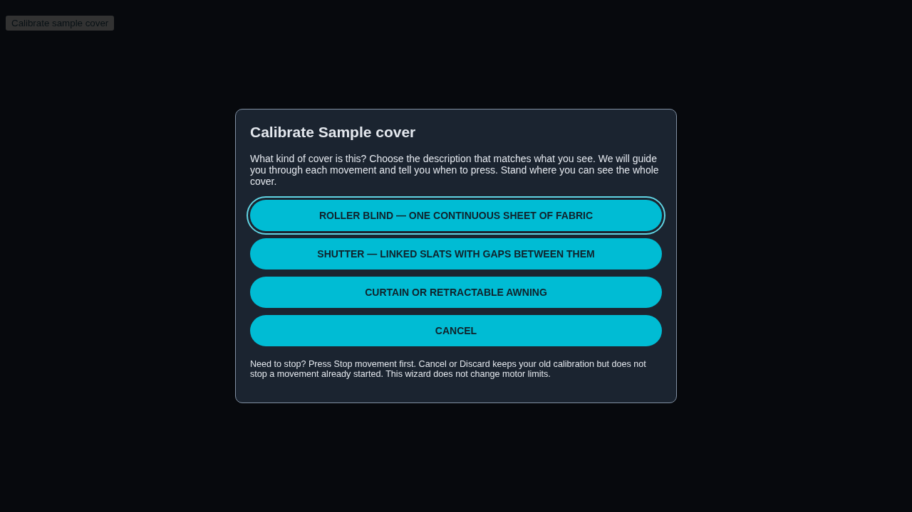
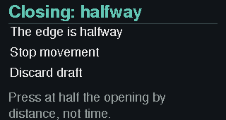

# Calibrate shutter positioning

Calibrate each shutter while standing where you can see its full travel. The controller estimates position from time; ordinary Somfy RTS motors do not send their actual position back.

In the web interface, edit a saved device and select **Guided calibration**. On the LILYGO, open that device's controls, select **More → Guided calibration**, and choose what kind of cover you see. You do not need to know its travel time or whether it has mechanical play. On the LCD, read **Before you start**, then select **Start guided checks**.

Choose **Fabric roller blind** for a continuous sheet, **Shutter with linked slats** for strips with gaps, or **Curtain / awning** for those covers. Curtains and awnings receive the additional movement-delay checks. Devices with separate tilt movement, gates, garage doors and switches are not supported by this positioning wizard. The controller checks eligibility before any movement.

1. Select **Open fully**. Wait until the cover is completely open and the motor has stopped, then select **It is fully open**. Curtains should be fully apart and awnings fully retracted. Existing motor limits must already work; this wizard does not set them.
2. Select **Start closing**. For slatted shutters and curtains/awnings, watch the main moving edge: the bottom edge of a shutter or blind, or the leading side of a curtain. Select **The edge started moving** at its first movement. Motor noise or individual gaps changing before the edge moves are not that observation; the controller records that delay separately.
3. Select **The edge is halfway** when the edge reaches half the opening **by distance**, not half the travel time or a displayed percentage. The cover keeps moving.
4. When shown, select **The edge reached the end** when that edge finishes travelling. Gaps between slats may still be changing. Wait until every slat has settled and the motor has stopped, then select **Fully at end; motor stopped** promptly.
5. Select **Start opening** and follow the same observations in the other direction. Roller blinds skip the extra first-movement and settling markers.
6. For slatted shutters and curtains/awnings, select **Check direction changes**. The cover moves towards closed; select **Halfway: stop here** at half the opening. Follow **Reverse upward**, then select **The edge started moving** at the first movement in the new direction. The wizard stops it automatically. Repeat for **Reverse downward**, then open fully and confirm again. Measure even an immediate response; you do not need to decide whether there is play.
7. Select **Save calibration**. The LCD shows this action before the optional timing details. The saved profile is used for this device and every group it belongs to. If you missed an observation, discard the draft and repeat the wizard.

**Stop movement** stops the cover and interrupts the measurement. **Discard draft**, Cancel or Back preserves the previous calibration but does not stop a movement already started. Press Stop first when you need movement to stop.

Timing starts at actual RF transmission, rather than when you click. No pairing or motor-limit programming is performed. One guide owns calibration at a time; unrelated controller commands are refused while it is active. A physical remote can interrupt the guide. Connection loss or cancellation may leave an accepted movement running to its existing motor limit.

Each member uses its own calibration for individual and group percentage moves. Test 25%, 50% and 75% individually, then as a group, in both directions. Record what you actually see, including stopping differences. Group members can start together and stop at different times.

These examples use synthetic measurements and the production renderer; they are not physical test results.

## Recover an uncertain position

Stopping during take-up or final settling, or an incomplete RF press, can leave mechanical progress unknown. The controller preserves that uncertainty across reboot. Percentage moves are then refused; full open and close commands remain available.

Open the guide, open fully, and confirm the physical endpoint. You can then discard the draft to keep the saved calibration. Entering a numeric position or waiting for an estimated endpoint does not count as observing the shutter.

An endpoint confirmation is an operator observation, not motor feedback. Manual movement, missed RF and changing mechanics can still cause drift. Reconfirm endpoints when needed; recalibrate if intermediate positions remain wrong.

## Capture a test report on release firmware

Open **Radio → Motion logs**, select Motion, Radio and/or Calibration, and choose **Capture for 5 minutes**. Optional USB output writes the same numeric events to the serial connection. Capture is off after reboot, expires automatically and supports at most 15 minutes through the API. It does not change the compile-time SDK logging level.

The web view keeps the latest 500 retrieved lines. The board retains only 32 records; a slow reader is told when records were overwritten. Copy the report before **Stop and clear**. Trace records contain controller shutter IDs, timestamps, RF tickets and numeric values, without radio addresses or credentials. Radio events establish transmission outcomes; they cannot prove the motor received a command. Radio kind 0 means started, 1 finished, 2 aborted and 3 dropped. Motion kind 0 means up, 1 stopped and 2 down. Motion values are visible percentage multiplied by 100; calibration values are 1 for accepted and 0 for refused.

Use the [release-board test routine](release-board-testing.md) to distinguish automated controller checks from observed motion.
